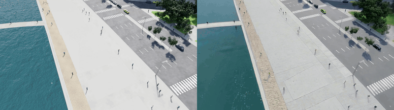
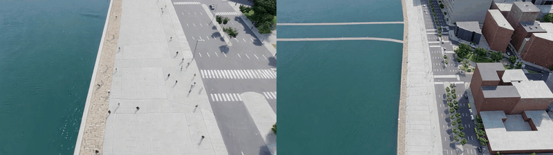
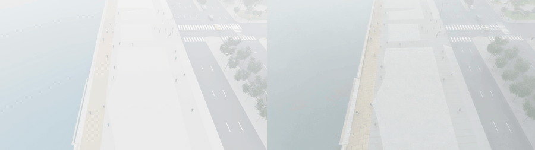
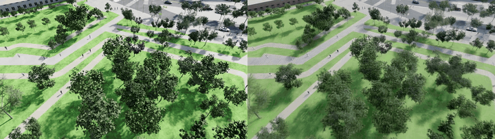
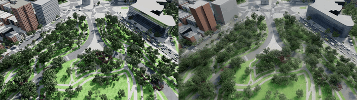

# nyc-drone-sim

A digital twin of any New York City location, built from the city's open data and flown as a drone
in NVIDIA Isaac Sim at any altitude. A video model, Cosmos-Transfer2.5, then restyles the render
into realistic video. Fog comes from the simulator: a fog render guides the model's colours.

## Results

Simulator render on the left, generated video on the right (GIFs are cut and scaled down; the
full videos are in the [v1.0 release](https://github.com/satyam19k/nyc-drone-sim/releases/tag/v1.0)).

| | |
| --- | --- |
|  |  |
| Canal Street at 150 ft, through the turn from the river onto Canal Street | Generated Canal Street at 150 ft (left) and 500 ft (right), same flight |
|  |  |
| Hudson River Park in fog at 150 ft: the simulator's fog render guides the colours | 1 East 161st Street, Bronx, at 150 ft |
|  | |
| Grand Army Plaza, Brooklyn, at 500 ft | |

| Video | Place | Altitude | Weather | Length |
| --- | --- | --- | --- | --- |
| [canal-shore-street_150ft_clear_M2_30s.mp4](https://github.com/satyam19k/nyc-drone-sim/releases/download/v1.0/canal-shore-street_150ft_clear_M2_30s.mp4) | Hudson River Park, then Canal Street | 150 ft | clear | 30 s |
| [canal-shore-street_500ft_clear_M2_30s.mp4](https://github.com/satyam19k/nyc-drone-sim/releases/download/v1.0/canal-shore-street_500ft_clear_M2_30s.mp4) | Hudson River Park, then Canal Street | 500 ft | clear | 30 s |
| [canal-shore-street_150ft_fog_fogguide_15s.mp4](https://github.com/satyam19k/nyc-drone-sim/releases/download/v1.0/canal-shore-street_150ft_fog_fogguide_15s.mp4) | Hudson River Park | 150 ft | fog | 15 s |
| [bronx-1-east-161st-street_150ft_clear_M2_15s.mp4](https://github.com/satyam19k/nyc-drone-sim/releases/download/v1.0/bronx-1-east-161st-street_150ft_clear_M2_15s.mp4) | 1 East 161st Street, Bronx | 150 ft | clear | 15 s |
| [grand-army-plaza-brooklyn_500ft_clear_M2_15s.mp4](https://github.com/satyam19k/nyc-drone-sim/releases/download/v1.0/grand-army-plaza-brooklyn_500ft_clear_M2_15s.mp4) | Grand Army Plaza, Brooklyn | 500 ft | clear | 15 s |

All are 1280 x 720 at 16 fps. The release also holds the simulator clip of each video
(`<name>_sim.mp4`), a side-by-side of each (`<name>_sim_vs_gen.mp4`), the 150 ft and 500 ft
Canal Street clips side by side, the inputs of every model run (`specs.zip`), and `SHA256SUMS`.

- Water, paving, trees, lawns and traffic look real, and the geometry follows the render frame
  for frame: streets, crossings, cars and buildings stay where the simulator put them.
- Facades lose detail. At 500 ft the window grid of large buildings disappears and they become
  plain grey or glass blocks; at 150 ft a tall facade softens near the end of the Canal Street clip.
- In the fog clip the fog thickens in one step at 5.8 s, where the model starts its second
  93-frame chunk (about 4.5% brighter). Everything else in that clip is continuous.
- Snow is not in the results; see [Known limits](#known-limits).

## How it works

1. An address (geocoded with NYC GeoSearch) or a route file.
2. City data for the area: building footprints and heights, streets, sidewalks, water, parks,
   trees and street furniture, all cached with their URL and SHA-256.
3. A USD scene in metres, Z up: one closed mesh per building, ground layers, vehicles,
   pedestrians and trees, with a semantic class on every object.
4. A collision-free flight at each altitude, at constant speed, with the camera pitched 45 degrees down.
5. The render in Isaac Sim: colour, depth, segmentation and edge videos, metric depth and the
   camera pose of every frame.
6. Checks that read the files back: heights in metres, closed meshes, camera poses, centre depth
   against altitude, a repeat render of frame 0.
7. Control videos for the model: depth, edges and segmentation, cut to the frames to restyle.
8. Cosmos-Transfer2.5-2B with setting M2 (below), one model run per clip, each 93-frame chunk
   continuing from the last frame of the one before.
9. For clips longer than one model run, `nyc-drone join` cross-fades two runs over their shared frames.

## Quickstart

After the [installation](#install):

```bash
source env_cpu/bin/activate
export OMNI_KIT_ACCEPT_EULA=YES                  # after reading the Isaac Sim licence
nyc-drone run --address "1 East 161st Street, Bronx" --altitude-ft 150 --duration-s 15 --look enhanced --dry-run
nyc-drone run --address "1 East 161st Street, Bronx" --altitude-ft 150 --duration-s 15 --look enhanced
nyc-drone generate --address "1 East 161st Street, Bronx" --altitude-ft 150 --duration-s 15 \
    --model-setting M2 --method chain
nyc-drone reproduce canal-shore-street --poses-only   # CPU only: replans a saved route and compares poses
nyc-drone reproduce canal-shore-street --look enhanced
```

`--dry-run` prints the resolved coordinates, the scene size, the frame count, the hardware each
step needs and a time estimate, and runs nothing. `run` writes the scene, the render and the check
results under `runs/1-east-161st-street-bronx/`; `generate` adds
`150/weather/clear_M2_chain_0000_0240.mp4`. Before any work, `run`, `route` and `reproduce` stop
with what to install if Isaac Sim, the GPU or (for the video model) the model's environment is
missing, and download the vehicle, tree and pedestrian models if they are not there yet.

If a step stops with `ConnectionError` or `Connection reset by peer`, the city's data server
dropped a request. Run the same command again: every response already received is cached under
`data/cache/`, so the rerun continues from the failed request.

## Reproduce the results

[docs/reproduce_results.md](docs/reproduce_results.md) lists every command that made the five
videos, in the order they ran, at commit `674cc7e`: the Canal Street scene, five renders, seven
model runs and two joins. Each step has its output, wall time and peak GPU memory. On one
NVIDIA RTX PRO 6000 (96 GB) the renders took 1 h 36 min and the model runs 4 h 54 min.

## Hardware and time

Rendering needs an NVIDIA GPU with ray-tracing (RT) cores: an L40S, RTX 6000 Ada, RTX PRO 6000 or
RTX 4090. A100, H100, H200 and B200 have no RT cores and cannot render. The video model needs
about 65 to 72 GB of GPU memory. One RTX PRO 6000 (96 GB) ran both, one after the other.

| Step | Hardware | Measured |
| --- | --- | --- |
| `scene` (data, scene, flight paths) | CPU; internet on the first run of a place | Canal Street route: 7.8 min. Under 1 min for a 400 m scene; 13 to 60 min for an 800 m scene |
| `render` | RT-core GPU; 3.5 to 4.2 GB of its memory | RTX PRO 6000: 0.41 s per frame at 150 ft and 1.35 s at 500 ft when writing to local disk; 1.08 and 2.16 s per frame when writing to a network-mounted disk. L40S: 1.16 to 1.31 s per frame. Start-up 82 s on a new machine (shader cache), 21 s after |
| `check` | CPU | render checks of two 768-frame altitudes: 5.2 min |
| `generate`, one 93-frame window | 80 GB GPU, Linux x86-64, glibc 2.35 or newer | 17.5 to 22.7 min, of which 5 to 7.5 min load the model; peak 64.8 to 69.2 GB |
| `generate`, a 240-frame chain (3 chunks, 15 s) | the same | 41.1 to 42.3 min; peak 70.6 to 71.2 GB |
| `generate`, a 30 s clip (two 248-frame chains, then `join`) | the same | 83.9 and 85.8 min; peak 70.6 GB |

The model takes about 11 minutes per 93-frame chunk (35 steps at about 19 s each) on the
RTX PRO 6000, and loads again for every command. `join` takes 4 s on the CPU.

Disk, as installed: CPU environment 0.9 GB, simulator environment 50 GB (the Isaac Sim packages
and extension cache), model environment 19 GB, model weights 46 GB. A render of 185 frames at
one altitude took 1.1 GB (videos, every frame as PNG, metric depth and segmentation).

## Install

Linux x86-64 with an NVIDIA driver. Install git, [uv](https://docs.astral.sh/uv/) and the two
system libraries Isaac Sim needs (Ubuntu package names), then clone:

```bash
sudo apt-get install -y git libegl1 libxt6          # libEGL.so.1 and libXt.so.6, for Isaac Sim
curl -LsSf https://astral.sh/uv/install.sh | sh
git clone https://github.com/satyam19k/nyc-drone-sim.git && cd nyc-drone-sim
```

Without `libegl1` and `libxt6` the RTX renderer does not start and every render fails. In a
container, the NVIDIA graphics libraries must also be available; if the renderer still fails,
create the container with `NVIDIA_DRIVER_CAPABILITIES=all`.

### 1. CPU environment: data, scenes, flight paths, checks

```bash
uv venv env_cpu --python 3.12
uv pip install --python env_cpu/bin/python -e ".[test]"
env_cpu/bin/python -m pytest -q tests               # every test passes or is skipped
```

Measured: 118 passed and 1 skipped in about 25 s. The skipped test needs `cv2`, which only the
model environment has. On a fresh clone one more test is skipped until the first scene with
objects has downloaded the vehicle, tree and pedestrian models.

### 2. Simulator environment: Isaac Sim 6.2 for the render step

Tested with Isaac Sim 6.2.0 on an NVIDIA L40S (driver 610.43.02) and an RTX PRO 6000 Blackwell
Server Edition (driver 595.112.07).

```bash
uv venv env_sim --python 3.12
uv pip install --python env_sim/bin/python "isaacsim[all,extscache]==6.2.0" \
    --extra-index-url https://pypi.nvidia.com --index-strategy unsafe-best-match
export OMNI_KIT_ACCEPT_EULA=YES                     # after reading the Isaac Sim licence
env_sim/bin/python -c "from isaacsim import SimulationApp; app = SimulationApp({'headless': True}); print('Isaac Sim works'); app.close()" 2>&1 | grep -E "Isaac Sim works|\[Error\]"
```

`--index-strategy unsafe-best-match` is needed: one of Isaac Sim's pinned dependencies
(`mujoco-usd-converter==0.6.1`) is on PyPI but not on NVIDIA's index, and without the option uv
stops with "No solution found when resolving dependencies". The install took 27 minutes on a
network-mounted disk.

The test line must print `Isaac Sim works` and no `[Error]` line about Vulkan, `GPU Foundation`
or a library that could not be loaded. `Isaac Sim works` alone is not enough: it is printed, and
the command exits 0, even when the renderer failed to start, for example with
`vkCreateInstance failed ... ERROR_INCOMPATIBLE_DRIVER` or `libXt.so.6: cannot open shared object
file` when the two system libraries are missing. One `[Error]` line is harmless:
`Skipping insecure template directory`, printed when the install is on a disk that makes every
file world-writable. The test line took 87 to 177 s on a new machine. The command finds the
simulator at `env_sim/bin/python`, or wherever `NYC_DRONE_SIM_PYTHON` or `--sim-python` points.

### 3. Video-model environment (only for the video model)

The model, [Cosmos-Transfer2.5](https://github.com/nvidia-cosmos/cosmos-transfer2.5), is pinned
to commit `2ff49d0717af02057ae79bc75c00fbff9da1b4e7`. Its own requirements: an NVIDIA GPU of the
Ampere generation or newer, driver 570.124.06 or newer (CUDA 12.8), glibc 2.35 or newer,
[git lfs](https://git-lfs.com/), and the system library `libGL.so.1` (package `libgl1` on Ubuntu)
for its OpenCV build.

```bash
git clone https://github.com/nvidia-cosmos/cosmos-transfer2.5.git external/cosmos-transfer2.5
git -C external/cosmos-transfer2.5 checkout 2ff49d0717af02057ae79bc75c00fbff9da1b4e7
git -C external/cosmos-transfer2.5 lfs pull
(cd external/cosmos-transfer2.5 && UV_PROJECT_ENVIRONMENT=$PWD/../../env_gen uv sync --extra=cu128 --python 3.10)
```

`--python 3.10` is required: the model's pinned packages do not exist for newer Pythons. The
command finds the checkout at `external/cosmos-transfer2.5` and its Python at
`env_gen/bin/python`; `MODEL_REPO` and `MODEL_PYTHON`, or `model.repo_dir` and `model.env_dir` in
`configs/gen.yaml`, point elsewhere.

**Hugging Face access.** The weights are on Hugging Face. Create an account and a
[read token](https://huggingface.co/settings/tokens), and accept the licence on each of these
three gated pages while logged in:

- [nvidia/Cosmos-Transfer2.5-2B](https://huggingface.co/nvidia/Cosmos-Transfer2.5-2B)
- [nvidia/Cosmos-Predict2.5-2B](https://huggingface.co/nvidia/Cosmos-Predict2.5-2B)
- [nvidia/Cosmos-Guardrail1](https://huggingface.co/nvidia/Cosmos-Guardrail1)

Put the token in the environment as `HF_TOKEN` (never in a file of this repository). The model
downloads its weights on first use; to download them in advance, with the revisions the model's
pinned commit asks for:

```bash
export HF_TOKEN=...                                 # your read token
dl() { uvx "hf>=1.3.5" download "$@" --quiet; }
T=nvidia/Cosmos-Transfer2.5-2B
dl nvidia/Cosmos-Guardrail1 --repo-type model --revision d6d4bfa899a71454a700907664f3e88f503950cf --include "*"
dl $T --repo-type model --revision b67b64abda3801a9aceddbff2bdb86126c06db74 general/edge/61f5694b-0ad5-4ecd-8ad7-c8545627d125_ema_bf16.pt
dl $T --repo-type model --revision dea7737ca29dd8d9086413c6dc5724b8250a0bb4 general/depth/626e6618-bfcd-4d9a-a077-1409e2ce353f_ema_bf16.pt
dl $T --repo-type model --revision eb5325b77d358944da58a690157dd2b8071bbf85 general/blur/ba2f44f2-c726-4fe7-949f-597069d9b91c_ema_bf16.pt
dl $T --repo-type model --revision 23057a4167b89de89a4a397fdbf3887994d115eb general/seg/5136ef49-6d8d-42e8-8abf-7dac722a304a_ema_bf16.pt
dl nvidia/Cosmos-Predict2.5-2B --repo-type model --revision f176dc95b4a70f53ce01c4b302851595e7322b00 tokenizer.pth
dl nvidia/Cosmos-Reason1-7B --repo-type model --revision 3210bec0495fdc7a8d3dbb8d58da5711eab4b423 --include "*"
dl Qwen/Qwen3Guard-Gen-0.6B
dl google/siglip-so400m-patch14-384
HF_HUB_OFFLINE=1 UV_OFFLINE=1 env_gen/bin/python -m nyc_drone_sim.gen.offline_check    # every file found offline
```

All four control checkpoints are needed even when fewer controls are used: the model loads every
branch. "Access denied ... requires approval" means that page's licence has not been accepted.
With the weights downloaded, set `HF_HUB_OFFLINE=1` so the model does not go online.

[docs/quick_test.md](docs/quick_test.md) checks a new install end to end with short clips: the
Canal Street scene, three renders and five model runs. After the install, its steps 1 to 8 took
2 hours on one RTX PRO 6000.

## Commands

| Command | What it does |
| --- | --- |
| `nyc-drone run --address ...` | scene, render, checks and, with `--realism model`, the video model, for an address or `--lat`/`--lon` |
| `nyc-drone route FILE` | the same for a route file |
| `nyc-drone reproduce NAME` | `route` on `configs/routes/NAME.yaml`, then compares the planned camera poses with `NAME.expected_poses.json`; exits 1 above 5 cm or 0.2 degrees |
| `nyc-drone scene`, `render`, `generate`, `check` | one step, with the same location or route arguments; a scene already built with the same options is reused |
| `nyc-drone join A.mp4 B.mp4 --overlap N --out C.mp4` | cross-fades two generated clips that share `N` frames into one |

`run`, `route` and `reproduce` exit 1 when a check fails; `report.json` lists each check as
`passed` or `failed`.

## Options

| Group | Options |
| --- | --- |
| Location | `--address` (street address, intersection or place), or `--lat` and `--lon`; `--radius-m` |
| Flight | `--altitude-ft` (one or more), `--duration-s`, `--speed-mps`, `--path street` (default) or `auto` |
| Camera | `--pitch-deg`, `--focal-mm` or `--fov-deg`, `--resolution WIDTHxHEIGHT`, `--fps` |
| Scene | `--seed`, `--objects on` or `off` (vehicles, pedestrians, trees, street furniture) |
| Look | `--look standard` (default) or `enhanced`; `--sim-weather clear` (default) or `fog` (the renderer's heavy fog, standard look only) |
| Video model | `--realism none` (default) or `model`; `--model-setting K2`, `M2` or `t4`; `--weather clear` (default), `snow`, or `fog` (alone, with `--guide-video`); `--method window` (default; one 93-frame window from `--start`) or `chain` (`--frames START:COUNT`, default the whole clip); `--guide-video PATH` (one per altitude) and `--guide-poses PATH`; `--specs-only OUT` |
| Route | `--poses-only`: fetch the buildings and plan the flight (and compare, for `reproduce`), nothing else; CPU only |
| Run | `--out`, `--config file.yaml`, `--dry-run`, `--offline`, `--sim-python` |

- `--path street` follows street centre lines and works for any length that fits in the scene.
  `--path auto` picks a short flyover, orbit or hover-and-pan around the location.
- `--config` takes a YAML file whose values replace those in `configs/default.yaml`.
- `--look enhanced` adds a sky-coloured ambient light with a soft sun, dark rippled water, ground
  textures sized in metres, and more varied walls, glass and roofs. It changes only light and
  materials: `checks/appearance.py` confirms that depth and semantic classes match a standard
  render of the same frames. M2 is meant for enhanced renders.
- `--guide-video` gives the model a colour video of the same flight (same frame count and camera
  poses, checked) to take its colours from, instead of the render's own `rgb.mp4`.
- `--specs-only OUT` writes the control videos, spec, prompt and `clip.json` of each clip and
  does not run the model, so the model can run on another machine.
- With a route, the flight options come from the route file; `reproduce` also keeps the camera
  the poses were saved with.

The render module also runs alone, with a frame range and the renderer's own weather:
`env_sim/bin/python -m nyc_drone_sim.sim.render --location NAME --altitude 150 --run NAME
[--frames START:COUNT] [--look enhanced] [--sim-weather clear|fog_light|fog_heavy|wet]`, and so
does the model step: `env_gen/bin/python -m nyc_drone_sim.gen.makeclip --run-folder RUN_FOLDER
--altitude 150 --weather clear --setting M2 --method window|chain [--start N] [--frames START:COUNT]
[--guide-video PATH]`. [docs/reproduce_results.md](docs/reproduce_results.md) uses both.

## Route files

A route is a YAML file in `configs/routes/`:

```yaml
origin: [40.719955, -74.012988]      # [latitude, longitude], or an address in quotes
altitudes_ft: [150, 500]
speed_mps: {150: 8, 500: 12}         # or one value for every altitude
seed: 2026
look: standard                       # or enhanced
sync_ground_track: false             # true: both altitudes share one ground track of the image centre
frames: 480                          # 30 s at 16 fps
waypoints_m: [[-45, -290], [-20, -150], [0, 0], [25, 150], [45, 280]]   # metres east, north of the origin
# or waypoints_lonlat: [[-74.0135, 40.7173], ...]
```

Optional: `motion_frames` (length of the recorded traffic, default `frames`), `buffer_m` (scene
extent around the route, default 768), `max_yaw_rate_deg_s`, and, without `sync_ground_track`,
`focus` (where along the route the clip is centred, 0 to 1, per altitude) and `yaw_offset_deg`.
`canal-shore-street.yaml` (Hudson River Park, then Canal Street, 48 s) and `hudson-park-run.yaml`
(30 s along the esplanade) are the routes of the existing renders; their `*.expected_poses.json`
hold every frame's camera pose from those renders.

## The video model

Cosmos-Transfer2.5-2B restyles a render using control videos made from it. Every clear result
above uses setting **M2**, from `configs/gen_prompts_windows.yaml`:

| Control | Weight | From |
| --- | --- | --- |
| depth | 0.5 | the render's depth |
| edges | 0.3 | the render's own edge video |
| segmentation | 0.5 | the render's semantic classes |
| colour (`vis`) | 0.3, blur preset high | the render's colour video, blurred by the model |

Guidance 3, 35 steps, seed 2026, 93-frame chunks at 1280 x 720. Because the colour control comes
from the render, M2 is meant for `--look enhanced` renders.

**The prompt is built from what is in view.** For a chain, the share of every semantic class
over its frames is measured, and each group of classes above its threshold adds one fixed
sentence (`configs/gen_prompts_classes.yaml`), followed by the weather paragraph. A sentence
about something that is not in frame makes the model paint it: naming the river over a park
produced a turquoise pool on a lawn with no water in view.

**Chain and window.** `--method window` restyles one 93-frame window. `--method chain` restyles
`--frames` in one model run: each 93-frame chunk starts from the last frame of the one before,
so the clip has no cut. A 240-frame chain is three chunks. For longer clips, two chains that
share frames are joined with `nyc-drone join`.

**Fog.** The simulator renders the same flight in its heavy fog (`--sim-weather fog`, or the
render module's `fog_heavy`). That fog render is the colour guide (`--guide-video`, weight 0.3,
blur high) of the enhanced render's depth, geometry edges and segmentation (setting `fog_guide`),
with the fog paragraph in the prompt. The guide must have the same frame count and camera poses
as the render it guides.

## What we learned

| Page | Finding |
| --- | --- |
| [01 Control weights](docs/ablations/01_control_weights.md) | Depth 0.5, edge 0.3, segmentation 0.5 looks real and keeps the layout; full weights are dull; depth alone breaks the layout |
| [02 Prompts](docs/ablations/02_prompts.md) | Naming each surface helps; naming something not in frame paints it in; one prompt for a long flight invents content |
| [03 Weather in the model](docs/ablations/03_weather_model.md) | A weather prompt alone barely changes the weather; fog works with the simulator's fog render as the colour guide |
| [04 Long clips](docs/ablations/04_long_clips.md) | Independent windows change look at every join; with M2 a chain is continuous, and three-chunk chains fit in 71 GB |
| [05 Look and renderer weather](docs/ablations/05_look_and_renderer_weather.md) | The enhanced look keeps geometry and speed; renderer fog works but its strength must be set per altitude; renderer wet weather is too weak to see |
| [06 Validation](docs/ablations/06_validation.md) | The simulator's geometry and altitude are right to 0.044%; no single score on generated video picks the best setting |
| [07 New addresses](docs/ablations/07_new_addresses.md) | The tool works unchanged in all five boroughs by address; rendering costs about 20 minutes per minute of video per altitude on an 800 m scene (L40S) |
| [08 Final run](docs/ablations/08_final_run.md) | Why M2, the final settings, and what still looks wrong |

## Checks

`nyc-drone check` runs the scene, flight-path and render checks on a run. Each check reads values
back from the files a step wrote, never from the step's own bookkeeping:

| Check | File | What it confirms |
| --- | --- | --- |
| data | `checks/data.py` | geocoding, complete download, heights in metres, a byte-identical rerun from cache |
| scene | `checks/scene.py` | units and axis, one closed mesh per building, volumes, footprint overlap, labels |
| probe | `checks/probe.py` | depth read in the simulator equals the altitude: catches unit errors |
| path | `checks/path.py` | constant altitude and speed, clearance from every building surface, field of view |
| render | `checks/render.py` | frame counts and rates, camera pose, depth against altitude, a repeat render of frame 0 |
| populate | `checks/populate.py` | placed vehicles, pedestrians and trees: positions, scale, motion, labels |
| appearance | `checks/appearance.py` | a look render keeps the depth and classes of a standard render |

The repeat render of frame 0 (render-7) fails only when depth or classes differ: at least 99.9% of
pixels must agree. Its colour PSNR below 35 dB is a warning, not a failure. Check reports and
pictures of the reference locations are in `docs/validation/`. `pytest tests` runs the unit tests
on the CPU without Isaac Sim, the model or the network, including a replan of both saved routes
against their expected poses.

## Known limits

- New York City only: every data source is a city dataset.
- Ground is flat at z = 0; terrain is not modelled.
- Buildings are footprints extruded to the recorded roof height with a generated window
  pattern. The model softens or drops facade detail, most at 500 ft, where large buildings
  lose their windows.
- Output is 1280 x 720 at 16 fps.
- In a chain, a chunk can start with slightly different light. In the fog clip the second chunk
  is about 4.5% brighter, so the fog thickens in one step at 5.8 s.
- Snow: setting t4 exists and `--weather snow` runs, but the class sentences of the prompt
  describe green trees, green lawns and dry paving, and they override the snow paragraph.
  Weather-specific class sentences would fix it; they are not implemented.
- Rain is not available.
- `--sim-weather fog` is not combined with `--look enhanced`.
- The repeat render of frame 0 has scored about 30 dB colour PSNR at some addresses: a renderer
  effect, not fixed. Depth and classes agree.
- A street clip must fit inside the scene. In an 800 m scene a 60 s clip at 150 ft may need a
  lower speed, and the route may not keep the address in view.
- Recorded traffic and pedestrian motion lasts as long as the clip the scene was built for.
- Vehicles and pedestrians are flat-coloured models; the enhanced sky is a uniform colour.

## Data sources and licences

The code is under the MIT licence (`LICENSE`).

City data comes from NYC Open Data (`data.cityofnewyork.us`), used under the city's open-data
terms of use: Building Footprints, the NYC Planimetric Database (Roadbed, Sidewalk, Median,
Public Plazas, Parking Lot, Open Space, Hydrography, Hydrography Structures, Boardwalk,
Transportation Structures), Centerline, Forestry Tree Points, Hydrants, Bus Stop Shelters,
Bicycle Parking and LinkNYC Kiosk Locations. Geocoding is by NYC Planning Labs GeoSearch.
Every response is cached under `data/cache/` with its URL, time and SHA-256.

3D models come from the Valdrada dataset by M. K. Turkcan
(`huggingface.co/datasets/mehmetkeremturkcan/valdrada`, tag `v0.7.1`), each part under its own
licence:

- Vehicles (`fleet24`): CARLA-derived models, credit "CARLA Simulator (carla.org)", CC BY 4.0;
  NYC buses, service and delivery vehicles by M. K. Turkcan, CC BY 4.0.
- Street trees (`bxtrees`): M. K. Turkcan, CC BY 4.0; leaf textures from ambientCG and bark
  textures from Poly Haven and ambientCG, CC0 1.0.
- Pedestrians (`peds24/rb27`): converted from the Microsoft Rocketbox Avatar Library,
  MIT licence, Copyright (c) 2020 Microsoft.

Rendered imagery that shows vehicles carries the credit "CARLA Simulator (carla.org), CC BY 4.0".
The models were converted to USD and, for vehicles and pedestrians, recoloured with flat colours.
The Valdrada pedestrian set under `peds24/bodies` is not used: its licence notice forbids
building datasets or training or testing models with it. Models and converted files live under
`data/assets/` and are not part of the repository.

Facade, roof, ground and water textures are generated by the code (`scene.py`,
`sim/appearance.py`); none are downloaded. The video model, Cosmos-Transfer2.5, is NVIDIA's,
under its own licence, and is installed separately.
