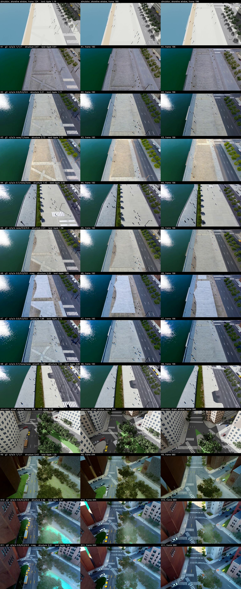
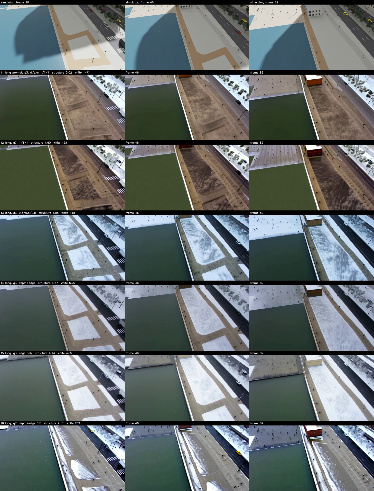

# 01 Control weights

**Question.** How strongly should depth, edge and segmentation steer the video model? Strong
controls keep our geometry; weak controls give the prompt room to make the picture look real.
Where is the balance, and which control is responsible for what?

## Settings

Common to every run: Cosmos-Transfer2.5-2B at commit `2ff49d0717af`, one H200, seed 2026,
35 steps, 1280 x 720 at 16 fps, one 93-frame window (5.8 s). Weights are written
depth / edge / segmentation; "none" means the control was not given to the model at all.

Clear grid, Canal Street 150 ft, `runs/run_009/canal-shore-street/150/gen/cosmos-transfer2.5-2b/clear_grid_93f/`
(shoreline window = frames 114-206, street window = frames 598-690; rendered edges):

| Run | Window | Guidance | Depth / edge / seg | Other |
| --- | --- | --- | --- | --- |
| K1 | shoreline | 3 | 1.0 / 1.0 / 1.0 | |
| K2 | shoreline | 3 | 0.5 / 0.3 / 0.5 | |
| K3 | shoreline | 3 | none / 1.0 / none | |
| K4 | shoreline | 3 | 0.7 / none / none | |
| K5 | shoreline | 3 | none / 0.5 / 0.5 | |
| K6 | shoreline | 3 | 0.5 / 0.3 / 0.5 | extra negative prompt |
| K7 | shoreline | 7 | 0.5 / 0.3 / 0.5 | |
| K8 | shoreline | 3 | 0.7 / none / none | dithered (smooth) depth |
| K9 | street | 3 | 1.0 / 1.0 / 1.0 | |
| K10 | street | 3 | 0.5 / 0.3 / 0.5 | |
| K11 | street | 3 | 0.5 / 0.3 / 0.5 | extra negative prompt |

Snow grid, Hudson 150 ft, first 93 frames, geometry edges, a 198-word snow prompt,
`runs/run_006/hudson-park-run/150/gen/cosmos-transfer2.5-2b/tuning_snow_93f/`:

| Run | Guidance | Depth / edge / seg | Prompt |
| --- | --- | --- | --- |
| t1 | 3 | 1.0 / 1.0 / 1.0 | long |
| t2 | 7 | 1.0 / 1.0 / 1.0 | long |
| t3 | 3 | 0.5 / 0.5 / 0.5 | long |
| t4 | 3 | 1.0 / 1.0 / none | long |
| t5 | 3 | none / 1.0 / none | long |
| t6 | 7 | 0.5 / 0.5 / none | long |
| t7 | 7 | 1.0 / 1.0 / 1.0 | short (46 words) |

## How it was measured

- **Structure score**: share of the output's edges within 3 px of the simulator's edges for the
  same frame, divided by the same share against edges from an unrelated clip. 1.0 means the
  output follows our scene no better than a random one. Threshold 1.5. Mean of six frames.
- **Land ripple**: strength of stripe-like texture on flat land (water excluded), away from real
  edges. Simulator: 1.19 on the shoreline window, 2.08 on the street window.
- **White ground** (snow only): share of flat non-water pixels that are bright and unsaturated.

## What we saw

Clear grid:

| Run | Structure (lowest frame) | Land ripple | By eye |
| --- | --- | --- | --- |
| K1 | 2.67 (2.49) | 0.91 | Dull grey paving, flat dark green water |
| K2 | 2.21 (2.13) | 1.77 | Blue-green water with sun sparkle, pale stone paving, dark asphalt. Looks like real footage |
| K3 | 2.73 (2.64) | 1.15 | Esplanade turns sand-coloured; road smeared |
| K4 | 1.43 (1.29) | 2.95 | **Fails the threshold**: invents a hedge, moves the crosswalk |
| K5 | 2.21 (2.13) | 1.56 | Close to K2; yellow taxis |
| K6 | 2.29 (2.15) | 1.89 | Bluish-white panels on the esplanade |
| K7 | 1.98 (1.84) | 2.12 | Sharpest picture, a little less faithful |
| K8 | 1.55 (1.37) | 3.89 | Invents a hedge; some frames below the threshold |
| K9 | 5.43 (4.75) | 1.30 | Geometry very tight, but dark: buildings are brown masses |
| K10 | 2.46 (2.26) | 2.47 | Real brick and glass facades, taxis, a school bus; a turquoise pool on the park lawn (see 02) |
| K11 | 2.41 (2.31) | 2.44 | Same as K10 |

Snow grid:

| Run | Structure | White ground | By eye |
| --- | --- | --- | --- |
| t1 | 2.73 | 14% | Snow only on the tree strip; promenade brown |
| t2 | 2.61 | 15% | Same, darker and blotchier |
| t3 | 2.69 | 31% | Snow on lawns and verges, streaky |
| t4 | 2.94 | 53% | Clean snow cover on lawns and verges, dark road, snowy trees |
| t5 | 3.04 | 47% | Like t4, a little noisier |
| t6 | 2.20 | 25% | Most photographic paving, patchy snow, geometry drifts |
| t7 | 2.53 | 8% | Almost no snow |

Seed check (K2 on the shoreline window, seeds 2026, 2027, 2028, `…/filler_93f/F10…`, `F11…`):
structure 2.21, 2.48, 2.57. The three outputs differ from each other by 27 to 29 grey levels per
pixel on average: as much as a change of weather (see 03).

## Conclusion

- **Full weights on all three controls (K1, K9, t1) keep the geometry but leave the picture dull
  and suppress weather.** Segmentation at full weight is what stops snow appearing: compare t1
  (14%) with t4 (53%), which differ only in segmentation.
- **Reduced weights, depth 0.5 / edge 0.3 / segmentation 0.5 (K2), are the clear-weather
  setting.** They pass the structure threshold on both windows and look like real footage.
- **Depth alone does not hold the scene** (K4, K8 fail or nearly fail). Smoothing the depth (K8)
  made it worse, not better. Depth is the control that prints the diagonal ripples: the two
  depth-only runs have by far the highest ripple scores.
- **Guidance 7 sharpens but costs structure** (K7 against K2; t6). **The extra negative prompt
  did nothing useful** (K6 worse than K2; K11 the same as K10).
- **Settings chosen:** K2 for clear weather; t4 (depth 1.0, edge 1.0 from the geometry edges, no
  segmentation) for snow.
- **What failed:** the ripple score. It ranks the dull K1 as the best run (lowest ripple),
  because real paving joints are stripes too. Choosing by that score, as the fallback rule did,
  picked the worst-looking setting for the first full clips. See 06.
