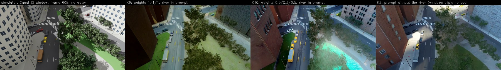
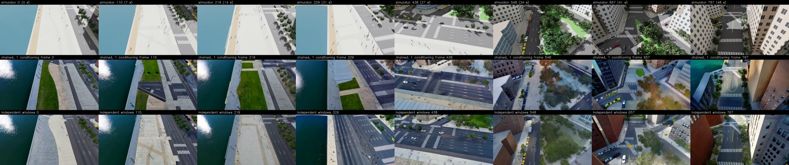

# 02 Prompts

**Question.** How much does the text prompt matter, and what in it goes wrong? The model takes
its layout from the controls and its appearance from the prompt, so the prompt decides what a
flat, untextured surface becomes.

## Settings

Same model, seed (2026), steps (35) and resolution as in 01. Prompts are a scene description
plus a weather paragraph, with no camera instructions.

| Prompt kind | Where it is written | Used by |
| --- | --- | --- |
| Short, 46 words: one scene sentence and one weather sentence | Spec files in `runs/run_006/hudson-park-run/150/gen/cosmos-transfer2.5-2b/windows_93f/` | The first four weathers, t7 |
| Long, about 190 words, one per window (shoreline, turn, street) | `configs/gen_grid_clear.yaml` | Clear grid K1 to K11 |
| Long, one for the whole flight | `configs/gen_prompts.yaml` | Chained full clips |
| Long, one per leg, each in a version with and without the river | `configs/gen_prompts_windows.yaml` | Window and piece clips. A window gets the river sentences only when at least 1% of its segmentation pixels are water |

## What we saw

**1. Short against long.** With the short prompt, water came out murky green and the promenade
as sand or lawn in all four weathers. The long prompt, which names each surface and its
material (granite seawall, wooden boardwalk, pale stone slabs), gave paving and blue-green water
once the control weights were lowered (K2). Length alone does not unlock weather: t1, with the
long snow prompt and full weights, shows 14% white ground; t7, short prompt and guidance 7, 8%.

**2. Mentioning water that is not there.** The clear-weather paragraph contained "The river is
deep blue-green with small ripples and sparkling highlights" and was attached to every window.
On the street window (frames 598-690) the simulator's segmentation has **0 water pixels**, yet
K10 and K11 painted a turquoise pool on the park lawn. With full weights (K9) the controls
overrule it and there is no pool. A street description also said "rooftops carrying vents and
water tanks". Both were removed: water is now described only where water is in frame, and the
clip builder refuses any prompt containing "water tank". The window clip made afterwards has no
pool at the same frame.

**3. One prompt for a whole 48-second flight.** The chained K2 clip of Canal Street had a single
prompt describing both the river and Canal Street. The street leg was told about a river, the
shoreline leg about a park lawn. Result: the paved esplanade became a green lawn for most of the
shoreline leg, a car park appeared at 7 s, and turquoise water appeared over a building in the
last frames. The window clip, with one prompt per window, kept the esplanade paved and put no
water on Canal Street.

**4. Weather text against scene text.** The snow grid prompt that produced snow (t4, 53% white
ground) described snow on each surface: snow on the promenade, the kerbs, vehicle roofs, bare
branches. The overnight weather runs used the standard scene text ("pale grey stone slabs, flat,
clean and dry", "leafy green street trees") followed by a snow paragraph, and showed no snow
cover. The likely reading is that the model follows the longer, more specific scene text when
the two contradict. **This is a hypothesis; it has not been tested.**

**5. Extra negative prompt** ("sand, desert, dunes, beach, green water, algae, CGI, video game
render, flat colours"): no useful effect (K6, K11; see 01).

### P1 to P3: the turquoise pool, tested on RunPod

Street window, Canal Street 150 ft, frames 598 to 690 (the window where K10 and K11 painted the
pool). Run on one A100 80 GB on RunPod.

| Run | Depth / edge / seg | Prompt |
| --- | --- | --- |
| P1 | 0.5 / 0.3 / 0.5 (K2) | No river or water words |
| P2 | 0.5 / 0.3 / 0.5 (K2) | The single full-clip prompt (the one the chained K2 clip used) |
| P3 | 0.7 / 0.5 / 0.8 | The single full-clip prompt |

> **Gap.** Sheet (`img/`, to be copied in), structure numbers and findings to be added.

## Conclusion

- **Describe every large surface and its material**, from what the segmentation shows in that
  stretch of frames. The model invents texture for anything left undescribed.
- **Never mention something that is not in frame.** A river sentence on a street window put
  water on a lawn.
- **One prompt per stretch of the flight**, not one for the whole clip. This is the main reason
  the window clips match the scene better than the chained clip.
- **Weather should be written into the scene description**, surface by surface, not appended.
  Untested; it is the first thing to try for weather (see 03).
- **What failed or is missing:** a prompt per chunk for chained clips. The model's pipeline
  accepts a list of prompts, one per chunk, but the stock command takes one prompt per clip, and
  the wrapper to use it has not been written.
