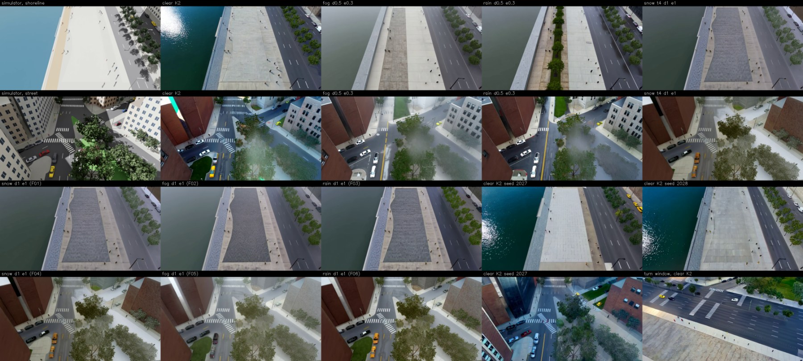
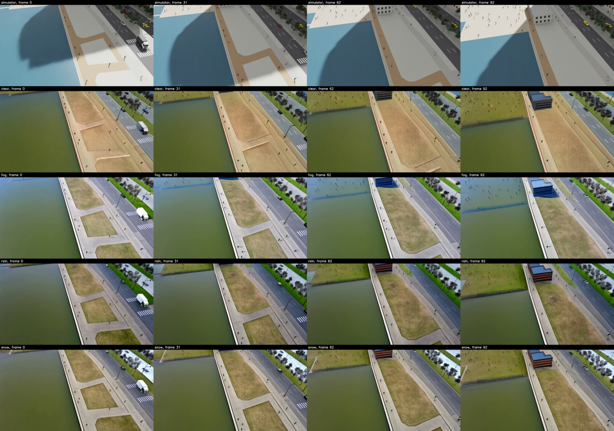

# 03 Weather with the video model

**Question.** Can Cosmos-Transfer2.5 change the weather (snow, fog, rain) while keeping the
simulator's geometry, and with which settings?

## Settings

Same model, seed (2026), steps (35) and resolution as in 01. Fog, rain and snow use the geometry
edges (outlines from segmentation and depth, without the simulator's cast shadows).

| Set | Folder (under `runs/…/gen/cosmos-transfer2.5-2b/`) | Settings |
| --- | --- | --- |
| First four weathers, Hudson, first 93 frames | `run_006/hudson-park-run/150/…/windows_93f/` | Depth / edge / seg 1.0 / 1.0 / 1.0, short prompt |
| Snow grid, Hudson | `run_006/hudson-park-run/150/…/tuning_snow_93f/` | See 01; long snow prompt describing each surface |
| Weather windows, Canal Street | `run_009/canal-shore-street/150/…/weather_windows/` | Snow: t4 (1.0 / 1.0 / none). Fog and rain: 0.5 / 0.3 / none |
| Short runs F01 to F06, Canal Street | `run_009/canal-shore-street/150/…/filler_93f/` | Snow, fog and rain all at 1.0 / 1.0 / none |
| Full snow clips | `run_009/canal-shore-street/150/…/snow_t4_windows/`, `run_006/hudson-park-run/150/…/snow_t4_windows/` | t4, independent windows, a prompt per window |

The fallback model considered, Wan2.1-VACE, was not tried.

## What we saw

Brightness and contrast are means over six frames (0 to 255). "White ground" counts bright,
unsaturated pixels on flat land; on the Canal Street shoreline the clear run already scores 35%
because the paving is pale, so there it does not measure snow. "Difference" is the mean absolute
pixel difference between two outputs of the same window.

First four weathers (Hudson, full weights, short prompt):

| Weather | Structure | Brightness | White ground |
| --- | --- | --- | --- |
| Clear | 2.04 | 111 | 2% |
| Fog | 2.74 | 126 | 31% |
| Rain | 2.84 | 98 | 10% |
| Snow | 2.82 | 109 | 23% |

The four differ by 14 to 30 grey levels from each other, but by eye fog has no haze, rain is a
slightly darker road, and snow has no snow.

Canal Street shoreline window (frames 114-206):

| Run | Settings | Structure | Brightness | Contrast | White ground |
| --- | --- | --- | --- | --- | --- |
| K2, clear | 0.5 / 0.3 / 0.5 | 2.21 | 109 | 64 | 35% |
| Fog | 0.5 / 0.3 / none | 2.22 | 138 | 45 | 40% |
| Rain | 0.5 / 0.3 / none | 2.00 | 115 | 54 | 33% |
| Snow | 1.0 / 1.0 / none (t4) | 2.76 | 105 | 34 | 3% |
| F01 snow | 1.0 / 1.0 / none | 2.77 | 105 | 34 | 3% |
| F02 fog | 1.0 / 1.0 / none | 3.00 | 112 | 35 | 13% |
| F03 rain | 1.0 / 1.0 / none | 2.79 | 98 | 38 | 8% |

Canal Street street window (frames 598-690):

| Run | Settings | Structure | Brightness | White ground |
| --- | --- | --- | --- | --- |
| K10, clear | 0.5 / 0.3 / 0.5 | 2.46 | 89 | 6% |
| Fog | 0.5 / 0.3 / none | 2.10 | 112 | 28% |
| Rain | 0.5 / 0.3 / none | 1.88 | 93 | 14% |
| Snow (t4) | 1.0 / 1.0 / none | 5.02 | 94 | 28% |
| F04 snow, F05 fog, F06 rain | 1.0 / 1.0 / none | 5.04, 6.88, 4.93 | 93, 113, 94 | 28%, 30%, 26% |

- **With depth and edge at full weight, snow, fog and rain look almost the same.** F01, F02 and
  F03 differ from each other by 15 to 22 grey levels; F04 to F06 by 18 to 30. By eye all six are
  the same flat grey overcast scene.
- **Lighter weights (fog and rain at 0.5 / 0.3) differ more** (28 grey levels on the shoreline),
  but by eye that is a lighter grey against a darker grey, not fog against rain.
- **Every weather run differs from its clear run by 36 to 48 grey levels**: the weather prompt
  changes the picture, toward a dull overcast look.
- **The model is reproducible.** The snow window and F01 have the same settings and nearly the
  same prompt; they differ by 1.8 grey levels.
- **Seed matters as much as weather.** Three seeds of K2 clear differ by 27 to 29 grey levels,
  as much as fog against rain.
- **Full snow clips:** Canal Street 150 ft snow is grey and flat, with no snow cover; the
  esplanade stays grey paving, the trees stay green, and the last window paints a white wall
  where a building should be (structure 4.36, lowest frame 2.80). Hudson snow is overcast with
  frosty paving and no snow cover (structure 2.72).
- **The only clear snow** is the Hudson snow-grid window t4 (53% white ground, with snow on
  lawns, verges and trees), made with a prompt that described snow on each surface.

## Conclusion

- **Weather does not work yet.** Fog, rain and snow come out as one grey overcast look. Geometry
  is kept in every run (structure 1.88 to 6.88, all above the 1.5 threshold).
- **Dropping segmentation is necessary but not sufficient.** It let snow appear on Hudson; on
  Canal Street it did not.
- **The likeliest cause is the prompt** (see 02): snow appeared only when the scene description
  itself said snow on each surface. The next test is to write each scene description per weather.
- **The view limits fog and rain.** At −45° from 150 ft there is no sky and nothing farther than
  about 110 m, so there is little for haze or falling rain to act on. Snow should still show as
  white ground, and it does not, so the view is not the whole story.
- **Not tried:** the fallback model, a style reference image, guidance above 3 for weather.

The findings above are kept as they were measured. What changed afterwards:

## Since then: the final run

**Fog works with a fog guide.** The renderer renders the same flight in its heavy fog
(`--sim-weather fog_heavy`), and that render becomes the model's colour guide: setting
`fog_guide` is depth 0.5, geometry edges 0.3 and segmentation 0.5 from the clear enhanced render,
plus the fog render as `vis` (weight 0.3, blur high), with the fog paragraph in the prompt. The
final fog clip (Canal Street, 150 ft, route frames 114 to 353, one 240-frame chain) is pale and
low in contrast, with the shoreline, crossings and trees still readable. Its second chunk starts
about 4.5% brighter (mean colour 208.7 / 205.3 / 203.4 in chunk 1, 218.2 / 215.4 / 214.1 in
chunk 2), so the fog thickens in one step at 5.8 s; the seam check flags that join (change 2.18,
limit 1.93). The guide must have the same frame count and camera poses as the render it guides.

**The cause of the snow failure is found.** A chain's prompt is built from the classes in view:
each class group adds a fixed sentence from `configs/gen_prompts_classes.yaml`, then the weather
paragraph follows. Those sentences describe "flat, clean and dry" sidewalks and plazas, "green
lawns" and "leafy green tree canopies" in every weather, and they outweigh the snow paragraph
that comes after them. This matches the observation above that snow appeared only when the scene
description itself said snow on each surface. The fix, class sentences written per weather, is
not implemented, so the v1.0 results have no snow. Rain is not available.
