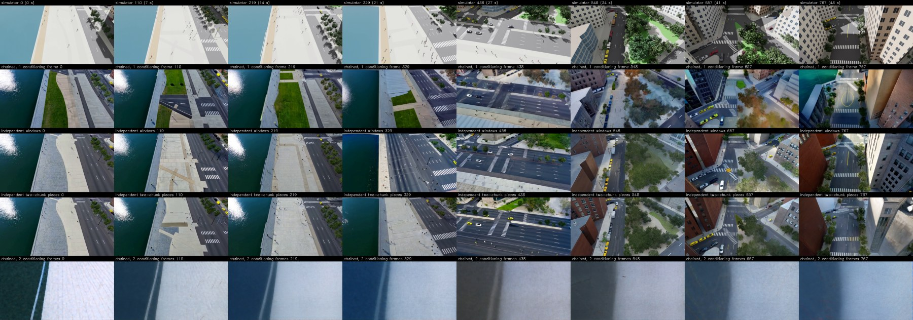
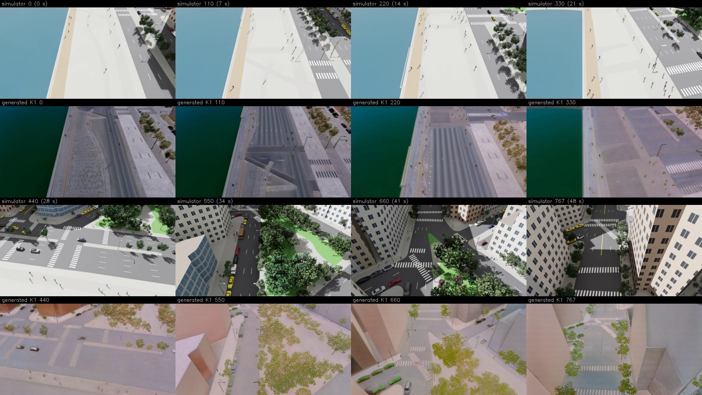

# 04 Long clips

**Question.** The model makes 93 frames (5.8 s at 16 fps) at a time. How do we make a 30 to 48
second clip that keeps its look from start to end, with no visible joins?

## Settings

Same model, seed (2026), steps (35) and resolution as in 01. Test clip: Canal Street 150 ft,
768 frames (48 s): 20 s along the shoreline, a 125° turn, then up Canal Street. Folders are under
`runs/run_009/canal-shore-street/150/gen/cosmos-transfer2.5-2b/`.

| Method | Folder | How it works |
| --- | --- | --- |
| Chained, K1 | `clear_K1_full/` | One run of the model over the whole clip. Each 93-frame chunk starts from the last frame of the previous one. One prompt. Full weights |
| Chained, K2 | `clear_K2_full/` | The same with K2 weights (0.5 / 0.3 / 0.5) |
| Chained, 2 conditioning frames | `clear_K2_chain_cond2/` | K2, each chunk starts from the last two frames. The model allows only 0, 1 or 2 |
| Independent windows | `clear_K2_windows/` | Ten 93-frame windows, each generated alone with its own prompt, 16 frames overlap, joined afterwards by cross-fade or hard cut |
| Independent two-chunk pieces | `clear_K2_pieces185/` | Five 185-frame pieces, chained inside a piece, independent between pieces, 16 frames overlap |

## What we saw

Brightness of each 93-frame stretch (0 to 255):

| Version | Brightness per stretch |
| --- | --- |
| Simulator | 176, 174, 177, 180, 163, 116, 103, 103, 112 |
| Chained, K1 | 82, 89, 102, 108, 144, 144, 142, 137, 138 |
| Chained, K2 | 91, 86, 87, 92, 117, 98, 91, 84, 84 |
| Chained, 2 conditioning frames | 140, 140, 138, 134, 128, 127, 131, 132, 132 |
| Independent windows | 106, 106, 108, 97, 104, 95, 91, 89, 80 |
| Two-chunk pieces | 106, 101, 106, 102, 93, 93, 84, 91, 99 |

The simulator itself darkens by about 40% along this flight, as the camera leaves the bright
esplanade for the street.

Structure score over eight frames of each clip (threshold 1.5) and the joins:

| Version | Structure (lowest frame) | Joins |
| --- | --- | --- |
| Chained, K1 | 5.03 (2.66) | 8 chunk joins, none flagged |
| Chained, K2 | 2.63 (2.17) | 8 chunk joins, none flagged (change at a join 5.1 to 11.6, limit 16.0) |
| Chained, 2 frames | infinite (3.33) | 6 of 8 joins flagged |
| Independent windows | 2.87 (1.89) | 9 joins; colour difference between neighbours 5.8, 6.9, 9.7, 13.5, **47.6**, **28.5**, 11.7, 20.9, 1.9 |
| Two-chunk pieces | 2.83 (2.28) | 4 joins; colour difference 8.9, 17.4, 9.8, 0.0 |

By eye:

- **Chained, K1:** washes out steadily to pink and beige by the street leg. The same happens at
  500 ft (brightness 66 rising to 120).
- **Chained, K2:** no washout and no visible joins; looks like real footage throughout. But it
  invents a lawn on the paved esplanade, a car park at 7 s and turquoise water over a building
  at the end, because one prompt covers the whole flight (see 02).
- **Chained, 2 conditioning frames:** collapses into a featureless blue-grey blur from the first
  chunk. Its structure score is infinite because the blank frames have no edges at all (see 06).
- **Independent windows:** the right layout everywhere, but the look changes at every join. The
  same paving is brown brick in one window and blue-grey slabs in the next; a building changes
  its facade. The cross-fade turns this into a one-second dissolve about every 4.8 s. The joins
  across the turn (47.6 and 28.5) are the worst.
- **Two-chunk pieces:** like the windows, with four joins in place of nine.

Other window clips, colour difference between neighbours: Hudson 150 ft 3.6 to 13.1; Canal
Street 500 ft 2.7 to 16.9; 120 Broadway 150 ft 7.2 to 32.9.

Why windows disagree: nothing ties one window's appearance to the next. Three seeds of the same
window and setting differ by 27 to 29 grey levels (03), so two windows generated apart differ by
about that much in their overlap.

Cost on one H200: a chained 768-frame clip took about 59 minutes and peaked at 108 GB of GPU
memory, so it does not fit an 80 GB card. Ten independent windows took 65 minutes at about
66 GB, which does fit.

## What failed along the way

- **The first window joiner** colour-matched each window to the one before it. The corrections
  added up along the clip and the end came out far too dark (−76% first to last). It was
  replaced by a plain cross-fade plus a version matched only within each overlap, and the clips
  were joined again.
- **The first two-chunk run** stopped with an error after four minutes and was run again.
- **The drift rule** (more than 10% brightness change, first chunk to last, means "use windows")
  passed the chained K2 clip at −8.4%, so the next clips were chained, although that clip invents
  content. Brightness was the wrong measure.
- **I called the window clip the best result** after looking at eight still frames, before
  watching it. In motion the joins are its main defect.

## Conclusion

- **Chaining is the only method that is continuous**, because each chunk starts from the last
  frame of the previous one. With K1 it drifts; with K2 it holds its brightness but follows a
  single prompt and invents content.
- **Independent windows get the content right but cannot be joined invisibly.** Cross-fading,
  hard cuts and colour matching all leave the change of look visible.
- **More conditioning frames is not available.** The model accepts 0, 1 or 2; 2 failed.
- **Next to try, untested:** chained K2 with one prompt per chunk, which keeps chaining's
  continuity and fixes its prompt problem; and windows that all share one style reference image,
  which may make them agree.
