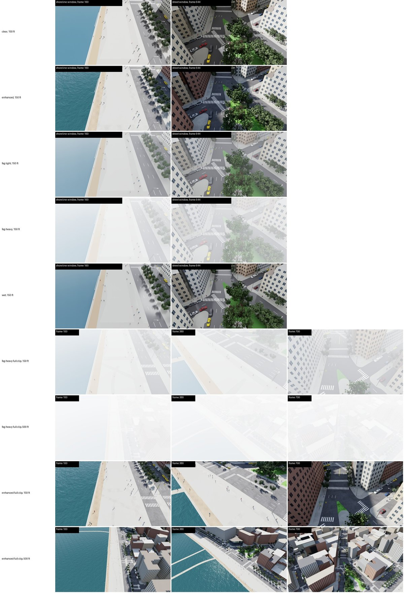
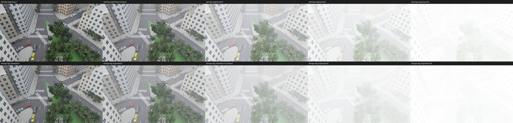

# 05 Look and renderer weather

**Question.** Without the video model, how far can the simulator itself go: a more realistic
look, and weather (wet ground, fog) made by the renderer? Does the geometry stay exact?

## Settings

Isaac Sim 6.2 on one L40S, 1280 x 720 at 16 fps, `render.rt_subframes` 4. Canal Street route,
the same frames as the clear render `run_009`: the shoreline window starts at frame 114 and the
street window at frame 598 (93 frames each), and the full clips are all 768 frames (48 s).

| Option | What it changes | Settings (`configs/default.yaml`, `appearance`) |
| --- | --- | --- |
| `--look enhanced` | Sky-coloured dome light with a wider, warmer sun; generated tiling maps for asphalt, concrete, grass and wood; dark rippled water; six wall tones, reflective glass, darker roofs | `enhanced` |
| `--sim-weather wet` | Overcast sky; road, sidewalk, plaza and other paved surfaces darkened to 0.6 and made glossy (roughness 0.12) | `weather.wet`, `weather.overcast` |
| `--sim-weather fog_light` | Overcast sky and the renderer's distance fog, colour strength 3, from 20 m to 500 m | `weather.fog_light` |
| `--sim-weather fog_heavy` | The same, strength 10, from 10 m to 320 m | `weather.fog_heavy` |

Nothing in the scene moves: the options change lights, materials and renderer settings only.
Tree and vehicle colours are not varied (they are shared instanced models), the sky is a colour,
not an image, and no texture is downloaded. `--look enhanced` and `--sim-weather` are not
combined yet.

"Contrast left" below is the spread of grey levels in a frame divided by the spread in the clear
frame at the same point of the flight: 1.0 is unchanged, 0 is a flat white or grey frame.

## What we saw

| Render | Folder | Frames | Contrast left | Looks like |
| --- | --- | --- | --- | --- |
| Enhanced look, 150 ft | `canal_look_enhanced_001` | 768 | 0.95 to 1.29 (median 1.14) | Right throughout: teal rippled water, brick and glass walls, textured paving |
| Enhanced look, 500 ft | `canal_look_enhanced_001` | 768 | 1.04 to 1.20 (median 1.12) | Right throughout |
| Wet, 150 ft, two windows | `wx_wet_shoreline`, `wx_wet_street` | 93 each | 0.80 to 0.89 | Barely different from clear: slightly darker paving, no visible sheen |
| Light fog, 150 ft, two windows | `wx2_fog_light_*` | 93 each | 0.53 to 0.70 | Light haze; everything visible |
| Heavy fog, 150 ft, two windows | `wx2_fog_heavy_*` | 93 each | 0.19 to 0.31 | Fog: buildings, cars and crossings show through a grey veil |
| Heavy fog, 150 ft, full clip | `canal_fog_heavy_001` | 768 | 0.15 to 0.31 | Fog, steady from start to end |
| Heavy fog, 500 ft, full clip | `canal_fog_heavy_001` | 768 | 0.05 to 0.08 | Almost white: ghost outlines, up to 37% of a frame pure white |

In motion, the enhanced clips change from frame to frame exactly as much as the clear render
does (median frame-to-frame difference 4.2 against 3.4 grey levels at 150 ft, 3.9 against 3.7
at 500 ft), with no jumps in brightness: the generated textures do not flicker. Both altitudes of the
enhanced clip, 2 x 768 frames, rendered and checked in 26 minutes, about 1 s per frame.

## Fog: why the first fog came out white

The fog colour strength was first chosen automatically from test frames in which the fog ended
1 m from the camera. There, strength 300 looked like a light haze. At the real fog distances
(tens to hundreds of metres) the same strength makes every frame white: the first fog windows
(kept as `wx_fog_*`) are 100% white pixels, contrast left 0.01 to 0.02.

A sweep at the real distances, two frames at frame 644 at 150 ft for each strength, was then
judged by eye and measured:

| Strength | Light fog: contrast left, white pixels | Heavy fog: contrast left, white pixels |
| --- | --- | --- |
| 1 | 0.76, 0% | 0.71, 0% |
| 3 | **0.68, 0%** (chosen) | 0.56, 0% |
| 10 | 0.48, 0% | **0.31, 0%** (chosen) |
| 30 | 0.24, 3% | 0.12, 26% |
| 100 | 0.08, 82% | 0.03, 100% |

Fog adds light with distance, so the strength that reads as fog depends on how far away the
ground is. At 150 ft the centre of the image is 65 m away; at 500 ft it is 215 m away. Strength
10 therefore reads as fog at 150 ft and as white at 500 ft (table above): **the 500 ft clip needs
a strength of its own**, chosen the same way so that its contrast left matches 150 ft heavy fog
(0.2 to 0.3). That render is the next step.

## Geometry check

Every render on this page passes the appearance check (`checks/appearance.py`) against the clear
render at the same frames: depth within 1% on 100% of compared pixels, the same class on 100% of
pixels, on every 4th frame (24 frames per window, 48 per full clip). The check compares depth and
classes only, so it also passed on the white frames of the first fog: it shows that the geometry
is untouched, not that the image is usable. The fog strength has to be judged on the colour
frames.

## Findings

- The enhanced look is a safe improvement: same geometry, same speed, no flicker.
- Renderer wet weather, as set, is too weak to see (contrast left 0.80 to 0.89).
- Renderer fog works, but its strength must be chosen per altitude.
- A geometry check cannot catch a white image; colour needs its own check or a look by eye.
