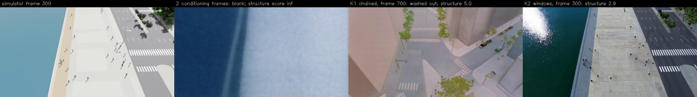
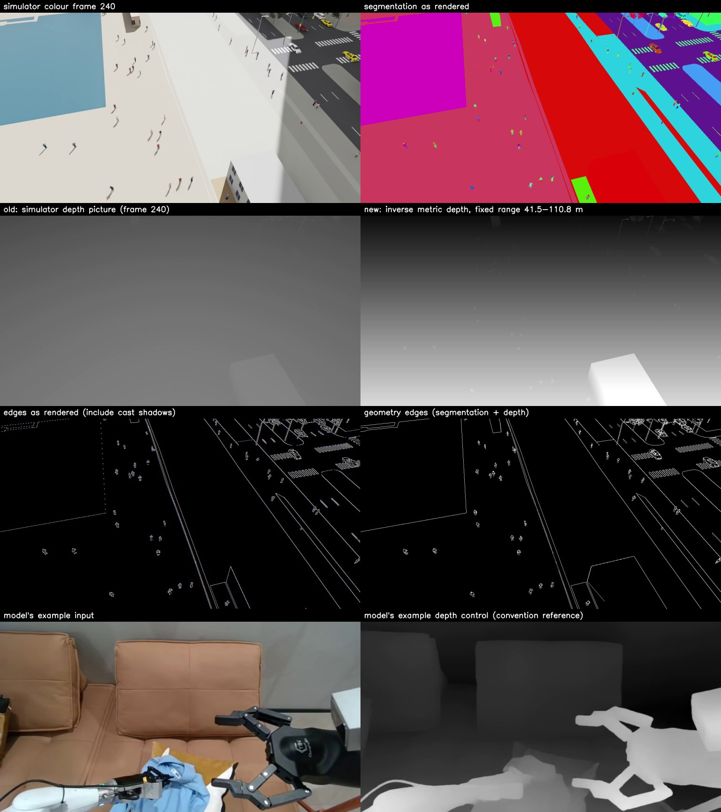

# 06 Validation

**Question.** Which checks can we trust? What do the simulator checks prove, what do the scores on
generated video measure, and where did a number say "good" when the picture was not?

## Simulator side: checks that held

| Check | What it proves | Result on Hudson, Canal Street and 120 Broadway |
| --- | --- | --- |
| Depth probe (probe-1 to probe-3) | The scene is in metres: depth straight down at known heights | 45.7200, 152.4000 and 50.0000 m, exact |
| Camera height from every ground pixel (render-10) | Altitude is right in every frame, not only at the centre | 45.720 m and 152.400 m, per-frame medians, 100% of ground pixels within 1% |
| Centre depth (render-3) | Depth along the view axis matches the altitude | Worst error 0.044% (limit 1%) |
| Placement (P1 to P13) | No vehicle off the road or inside a building, no pedestrian off the walkway, same seed rebuilds the same scene | Pass, except one parked taxi at 29.7° to its street in the Canal Street scene, outside both clips' view |
| Two-altitude sync (path-9) | Frame N at 150 ft and at 500 ft look at the same ground point | 0.0000 m apart over 768 frames (limit 1 m) |

Two of these checks were wrong at first and were corrected with the owner's approval: render-3
averaged depth over a block that could include a car or pole, and render-9 required a depth-picture
contrast that flat waterfront scenes can never reach. One real defect was found by measuring:
the label map saved with each clip listed only the classes in the last frame, so water, piers
and lawns were missing; it was fixed in the renderer and recovered for existing clips from the
scene itself (every recovered class agreed in at least 99.99% of tested pixels).

Pictures and reports for these checks are in `docs/validation/`: for example
`docs/validation/images/probe_canal-shore-street.png` (depth probe),
`docs/validation/images/path_canal-shore-street_long.png` (the camera path at both altitudes),
`docs/validation/images/render_canal-shore-street_150_long.png` and
`render_hudson-park-run_150_long.png` (rendered frames with depth, labels and edges), and the
matching JSON reports in `docs/validation/reports/`.

## Video-model inputs: checks that held

- **Specs:** every spec was loaded and validated by the model's own code before a GPU run, with
  every control file opened and its frame count and size compared with the input video.
- **Weights offline:** a CPU run on a machine with no GPU loaded every weight file with the network
  switched off. It caught three faults that would have failed on the GPU.
- **Depth control:** the grey levels written to the video match the formula from metric depth
  to within 0.5 of a level. On flat ground the 8-bit picture has contour lines up to the full
  1,280 px wide; a dithered version cut them to 20 to 26 px. (Using it did not help; see 01.)
- **Joiner:** run on the simulator's own frames as stand-ins, the joined clip matched the input
  at 38 dB in every frame, for both cross-fade and hard cut.

## Generated video: scores that misled

| Score | What it measures | Where it failed |
| --- | --- | --- |
| Structure: edge agreement with our scene ÷ agreement with an unrelated clip | Whether outlines are in the right place | A blank, blurred clip (2 conditioning frames) scores **infinite**, because it has no edges for the unrelated clip to match. The washed-out K1 clip scores **5.03**, higher than the good K2 clip (2.63), because it keeps outlines while losing everything else. It says nothing about appearance |
| Land ripple: oriented stripe texture on flat land | Diagonal ripple artefacts | Ranks the dull K1 window best (0.91) and the realistic K2 window poor (1.77), because real paving joints are stripes too. Used as the fallback rule, it chose the worst-looking setting |
| White ground: bright, unsaturated land pixels | Snow cover | Pale paving counts: the clear K2 shoreline window scores 35%, more than any snow run there |
| Brightness change, first chunk to last | Drift | The blurred 2-frame clip passes (−6%); the chained K2 clip passes (−8.4%) while inventing a lawn and water. The simulator's own brightness changes by about 40% along this flight, so the rule also mixes drift with the scene |
| Seam check: frame-to-frame change at chunk joins | Sudden jumps at chained joins | Passed the K1 clip that washes out: its damage is gradual. Does not see a change of look spread over a cross-fade |

The full-size version of this sheet is `docs/validation/images/gen_controls_hudson-park-run_150.png`.

## Judging by eye

- **Eight still frames per clip were not enough.** I called the window clip the best result from
  its stills; in motion its joins are its main defect. Joins have to be watched, frame by frame
  across each one.
- **Weather is judged by eye.** No score above tells fog from rain.

## Conclusion

- **The simulator checks are sound**: they measure geometry, which is what they are for, and
  they caught real defects.
- **No score on generated video can choose a setting by itself.** Structure is a floor (below 1.5
  the layout is wrong), not a ranking. Ripple, white ground and brightness drift each reward a
  failure mode.
- **Missing:** there is no check on generated video in the repository. The structure score was
  run on short windows and on eight frames of each full clip, by hand. A check for a change of
  look across a join would need to compare the two sides of each join in content, not just
  brightness.
