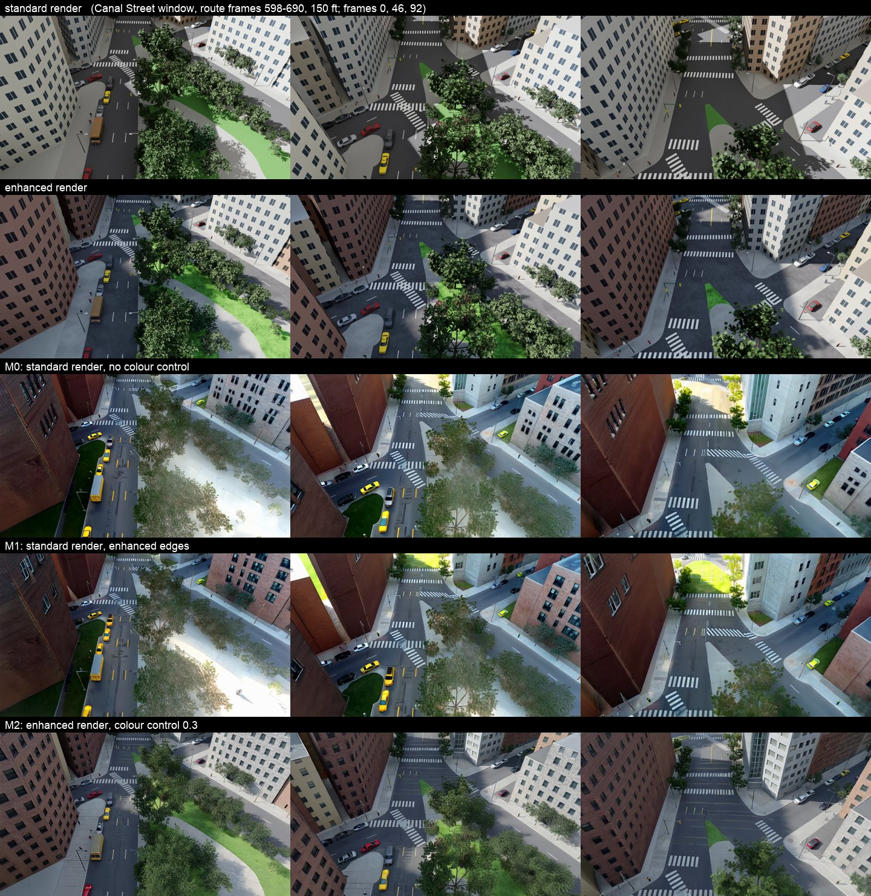

# 08 Final run

**Question.** Which input and colour control should the final clips use, and how do the five
final clips come out?

## Settings

Cosmos-Transfer2.5-2B at commit `2ff49d0`, seed 2026, guidance 3, 35 steps, 1280 x 720 at
16 fps, 93-frame chunks, on one RTX PRO 6000 (96 GB). Code at commit `674cc7e`.

## M0, M1 and M2

Two 93-frame windows of the Canal Street route at 150 ft and 500 ft: the shoreline (route frames
114 to 206) and the street (598 to 690). All runs use depth 0.5, edge 0.3 and segmentation 0.5
(K2) and a prompt per window that names the river only where at least 1% of the window is water.

| Run | Input video | Edge control | Colour control (`vis`) |
| --- | --- | --- | --- |
| M0 | standard render | standard rendered edges | none |
| M1 | standard render | edges of the enhanced render | none |
| M2 | enhanced render | standard rendered edges | 0.3, blur preset high, from the input video |

`vis` has no control file: the model blurs its input video and takes its colours from it. That
is why M2 uses the enhanced render as input. The other controls are files, so without `vis` the
input video is not used, and M0 and M1 differ only in their edge control. All twelve windows ran
in one batch with one model load: about 11 min per window, peak 69.5 GB.

Rows: the standard render, the enhanced render, then M0, M1 and M2, at frames 0, 46 and 92 of
the street window.

- **M0 and M1** turn the park's green lawn into a bright white plaza with pale trees, paint new
  lawns beside the road, and recolour many cars yellow. The edge control alone (M1 against M0)
  changes little.
- **M2** keeps what the render shows: the green park, the red, white and yellow cars, brick and
  stone facades with windows. Its light is the enhanced render's soft light.

M2 was chosen for the final clips.

## Final settings

| Clip | Setting | Depth | Edges | Segmentation | Colour guide (`vis`) |
| --- | --- | --- | --- | --- | --- |
| clear clips | M2 | 0.5 | 0.3, the render's own edge video | 0.5 | 0.3, blur high, the enhanced render |
| fog clip | `fog_guide` | 0.5 | 0.3, geometry edges | 0.5 | 0.3, blur high, the renderer's heavy-fog render of the same frames |

Each clip is one chain: three 93-frame chunks, each starting from the last frame of the one
before. The prompt is built from the classes in view over the chain's frames
(`configs/gen_prompts_classes.yaml`), then the weather paragraph. The 30 s clips are two chains
joined with `nyc-drone join` over 16 shared frames. Commands:
[reproduce_results.md](../reproduce_results.md).

## The five clips

| Clip | Frames | Seconds | Setting | Source render | Wall time | Peak GPU memory |
| --- | --- | --- | --- | --- | --- | --- |
| `canal-shore-street_150ft_clear_M2_30s.mp4` | 480 | 30 | clear, M2 | Canal Street enhanced, 150 ft, route frames 288-767 | 85.8 min | 70,621 MiB |
| `canal-shore-street_500ft_clear_M2_30s.mp4` | 480 | 30 | clear, M2 | Canal Street enhanced, 500 ft, route frames 288-767 | 83.9 min | 70,638 MiB |
| `canal-shore-street_150ft_fog_fogguide_15s.mp4` | 240 | 15 | fog, `fog_guide` | Canal Street enhanced, 150 ft (geometry), and its heavy-fog render (colours), route frames 114-353 | 42.4 min | 71,178 MiB |
| `bronx-1-east-161st-street_150ft_clear_M2_15s.mp4` | 240 | 15 | clear, M2 | `nyc-drone run`, enhanced, 150 ft | 41.7 min | 70,619 MiB |
| `grand-army-plaza-brooklyn_500ft_clear_M2_15s.mp4` | 240 | 15 | clear, M2 | `nyc-drone run`, enhanced, 500 ft | 41.2 min | 70,619 MiB |

The renders took 1 h 36 min and the seven model runs 4 h 54 min, one after the other on the same
GPU. No clip has a black or frozen stretch. Seam numbers per chain are in
[04](04_long_clips.md#result-in-the-final-run).

## What looks real

- Geometry follows the render frame for frame: streets, crossings, kerbs, cars, people and
  buildings stay where the simulator put them, through the 120-degree turn onto Canal Street.
- Water, paving, lawns, tree canopies and traffic look like aerial footage; foliage and road
  surfaces look more natural than in the render.
- At 150 ft and 500 ft the same flight gives two consistent clips.

## What still looks wrong

- **Facades.** Large buildings lose detail. At 500 ft (Grand Army Plaza and Canal Street) the
  window grid of tall white and glass buildings disappears and they become plain grey blocks. At
  150 ft, near the end of the Canal Street clip (route frames about 730 to 767), a tall white
  facade softens.
- **The fog step.** In the fog clip the second chunk starts about 4.5% brighter, so the fog
  thickens in one step at 5.8 s; the seam check flags that join. The rest of the clip is
  continuous.
- **No snow.** The class sentences of the prompt describe green trees and dry paving, which
  override the snow paragraph (see 03).

## Conclusion

- **M2 for the final clips:** the colour control from the enhanced render keeps the scene's
  colours; without it the model invents them.
- **Chains for continuity:** with M2 and class-based prompts, three-chunk chains have no
  visible join in clear weather and fit in about 71 GB.
- **Next:** weather-specific class sentences for snow; a way to keep facade detail at 500 ft
  (a stronger edge weight on buildings, or a higher resolution); matching brightness between
  chunks of a fog chain.
